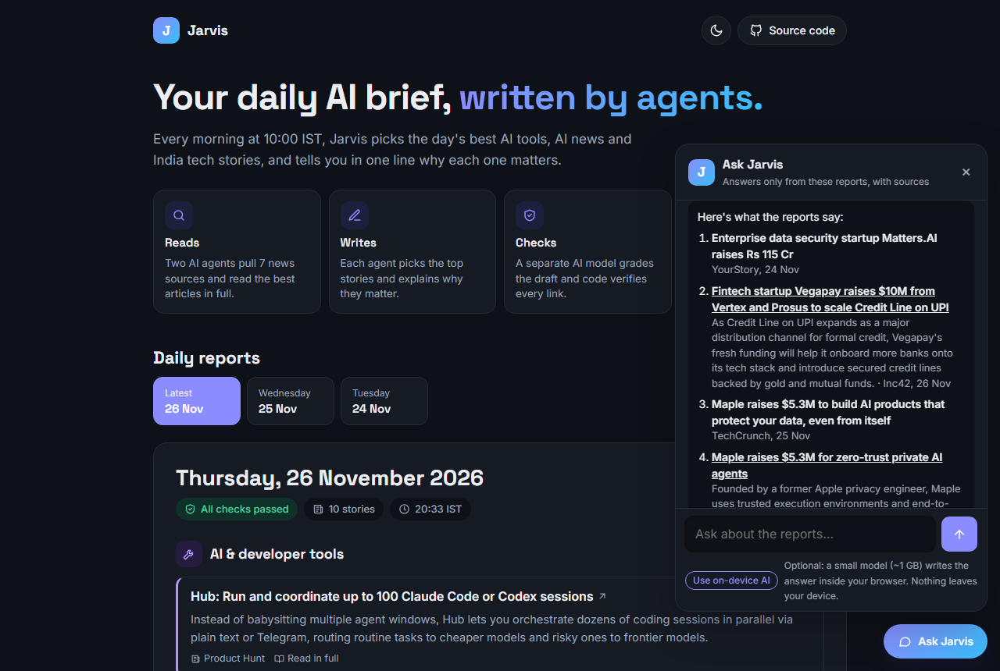

# Jarvis AI Agent

**A multi-agent AI system that writes a daily AI brief, checks its own work, and runs on its own every morning.**
Two AI agents research and write, a different AI model reviews their drafts, and plain code decides when the work is
really done. Nothing reaches the website until it passes every check.

[**Live site**](https://bsaiprasad13-main.github.io/jarvis-ai-agent/) · Runs daily at 10:00 IST on **Zoho Catalyst** · **68 offline tests** · **checker catches 39/39 invented details** ([measured](evals/), up from 4/10) · MIT license



## At a glance

| | |
|---|---|
| **What it does** | Reads 7 sources (Product Hunt, Hacker News, TechCrunch, VentureBeat, YourStory, Inc42, Business Standard) and writes three short sections for an engineer who builds with AI: **AI & developer tools**, **AI industry news**, **India tech & startups**. Each pick gets one or two plain lines on why it matters. |
| **The hard part it solves** | AI agents sound confident, say they're done when they aren't, and quietly make things up. Jarvis is built so it can't publish unchecked work, and when something breaks it recovers or says exactly where it broke. |
| **Ask Jarvis** | A chat on the website that answers from the reports only, with sources, and remembers the conversation ("tell me more about the second one"). Retrieval runs in the browser; optionally a 1.5B model (WebLLM, on WebGPU) writes the answer on the visitor's own device, and code rejects any answer that doesn't cite a real story. |

### How it maps to building conversational AI

| Skill | Where it shows |
|---|---|
| **Agents, function calling, tools** | Two Gemini desk agents with 7 tools each decide what to fetch, read, look up and submit (`jarvis_agent/agent.py`, `tools.py`) |
| **Prompt engineering and context management** | System prompts and the checker's rubric are built from one spec (`jarvis.config.json`); the checker is told exactly which sections each desk owns; lessons carry over to the next day |
| **RAG and reducing hallucinations** | Desks must read the article before explaining it; agent writers see story IDs, never URLs, so they can't invent links; background comes from a real lookup in Edgepedia (a free encyclopedia API); the chat answers only from retrieved stories and must cite them. **Measured:** in a labelled test the checker went from catching 4/10 invented details to 39/39 over 3 runs, including held-out cases, while passing every faithful draft ([evals](evals/)) |
| **Edge-case handling** | Early "finish", crashes, half-done work, model outages and quota limits each have a fixed route in code, and each has a test |
| **End-to-end deployment** | Spec → prompts and tools → offline tests → test runs with fault injection → production on Zoho Catalyst → alerts and a 10:30 watchdog |
| **Integrations** | Gemini, Product Hunt GraphQL, Hacker News API, RSS feeds, Edgepedia API, Resend email, Zoho Catalyst (Job Scheduling, Stratus), GitHub Pages |
| **Tuning from logs and latency** | Every model call is timed and logged with its report; each fix in section 5 came from reading run traces; the checker's prompt change was measured before and after (p50 3.0 s per check) |
| **On-device inference** | The optional chat model runs in the visitor's browser on WebGPU and reports time to first word |

## 1. How it works

```
 10:00 IST  Zoho Catalyst Job Scheduling starts the Job function
                         │
            ┌──────── Harness (plain code) ─────────┐
            │ contracts · time budgets · routing ·  │
            │ done-checks · final checks · alerts   │
            └─────┬─────────────────────────┬───────┘
                  ▼                         ▼
          Global desk (AI agent)     India desk (AI agent)          run in parallel
          fetch · read articles · search · Edgepedia background · draft
                  │                         │
                  ▼                         ▼
          Checker (a different AI model): scores 1–5 on 5 points, sends back exact fixes
                  │ accepted
                  ▼
          Done-check (code) ── fails ──► backup model ──► backup model ──► original pipeline (that desk only)
                  │ passes
                  ▼
          Final checks (code) ──► report + memory saved to Stratus and read back ──► website
                                   └─ anything wrong ──► alert email saying where
```

| Part | What it does | Where |
|---|---|---|
| **Desk agents** | Gemini with function calling and 7 tools. Each desk owns its own sources and sections and decides what to fetch, what to read in full, what to look up, and when its draft is ready. | `jarvis_agent/agent.py`, `tools.py` |
| **Checker** | A *different* model in a fresh context scores each draft on grounded, specific, relevant, best picks and honest, with evidence, and returns exact fixes. It sees each pick with the full text the desk read (up to 2,500 characters per article). Grounding must score 4 or more out of 5, and it also lists every factual claim: if the article doesn't support one, **code** fails the draft's grounding. Checker calls use temperature 0. | `jarvis_agent/evaluator.py` |
| **Harness** | Plain code. Gives each desk a contract, refuses `finish` until it's met, routes failures, enforces time budgets, and runs final checks. | `jarvis_agent/harness.py` |
| **Memory** | Links already published (no repeats for 14 days), feed addresses that worked, and one lesson per desk per day, read at the start of the next run. | `jarvis_agent/store.py` (Stratus `state/memory.json`) |
| **Agent spec** | Reader, sections and desks in one file. A new audience or new sources is a config change, not a code change. | `jarvis.config.json` |
| **Website** | One clean page: today's report and the previous days, each with a short "How this report was checked" panel, plus the Ask Jarvis chat. | `site/index.html` (GitHub Pages; reads reports from Stratus) |

## 2. Why it is reliable

Every rule below is enforced in code, not by asking the model nicely.

- **The agent can't decide it's done.** `finish` is refused until code confirms the desk's contract: every source tried, enough articles actually read (a page that failed to load doesn't count), every section filled (or honestly marked quiet when there really is little news), and the checker's approval. The refusal lists exactly what's missing.
- **The writer never grades itself.** The checker runs on a different model. If every independent model is unavailable, it falls back to the writer's model, and the report says so openly.
- **It can't invent links.** Agent writers only see story IDs like `g14`; code maps them back to the addresses that came from that morning's feeds, and a final check confirms every published link is one of them. Background links must come from a real Edgepedia lookup. (The last-resort fallback pipeline sees URLs, so the same final check covers it.)
- **Failures follow fixed routes, decided by code.** A writer that crashes, runs out of steps or stops half way is replaced by a backup model, then another, then the original one-call pipeline for that desk only. If the thing deciding what to do after a failure were itself a model, its own failure would go unnoticed.
- **It always finishes inside Catalyst's 15-minute job limit.** Writers get 5 minutes, backups 2.5 each, model retries stop when time is up, and time is always kept back for the fallback, publishing and the alert.
- **Nothing counts as published until it's read back.** After saving the report, the job reads it from Stratus and compares the links.
- **Web text is data, never instructions.** Article text is labelled as information, no tool can act on it, and the website escapes all text.

## 3. How it was tested

- **68 offline checks** (`python tests/test_agent.py`, with fake models and fake sources, run on every push together with the `ruff` linter). They cover:
  - a desk calling `finish` early, crashing, or stopping half done
  - every agent writer failing
  - the checker going down or returning broken JSON (this never costs the writer a draft)
  - weak grounding, invented IDs and background links
  - desks staying inside their contract, and a failed page read not counting as read
  - feed parsing (RSS and Atom) and duplicate detection
  - the time budget (writers skipped when time is short, the fallback still delivers)
  - lessons with links or "ignore previous" text are refused, so web text can't become tomorrow's instructions
  - no secrets in the committed Catalyst config
  - the alert rules
  - the **Catalyst Job function end to end**, with a fake SDK and an in-memory bucket: clean run, degraded run, and crash
- **Real runs with real models and sources**, including **fault injection** (`fault=india:writer`). In one test the India writer was crashed on purpose, both backup models then hit their quota (HTTP 429), and the original pipeline wrote the section. All final checks still passed.

- **A measured test of the checker** (`python evals/checker_eval.py after 3`, real model calls): 20 labelled drafts, half with one invented detail, plus 6 held-out long articles written after the fix. The first version of the checker caught **4/10**. After a claim-by-claim fact check that code enforces, full read text and temperature 0, it caught **39/39** over 3 runs and passed **38/38** faithful drafts. Details and every case: [`evals/`](evals/).

## 4. How we know it works every day

- **A report card for every run**, published on the website: each check marked PASS, FAIL or RETRIED (failed, then recovered automatically), with its evidence.
- **Alert emails, only when they matter:**
  - **FAILED:** the run crashed or a final check failed. The email names the failing check, what was recovered on the way, each desk's attempts, and the last lines of the error.
  - **Needs attention:** the brief went out, but the original pipeline had to write a section because every agent writer failed.
  - **No email** when a backup model quietly took over. That's normal operation, and it's visible on the report card.
- **A watchdog at 10:30 IST** (a second cron, same function, `watchdog=1`) checks that today's report was actually published with every check passed, and emails if not. It catches the failures a run can't report itself: Catalyst not starting the job, or stopping it hard.
- **Every model call is recorded** in the run's trace (model, response time, success, failure code), saved with the report in Stratus, so latency and failure rates can be checked per model.

## 5. What changed, and what the logs taught us

| Version | What changed | Why |
|---|---|---|
| v1 (separate repo) | One-call pipeline on Catalyst: fetch, one Gemini call, email at 10:00. Ran daily. This repo starts at v2. | It worked, but it wrote from headlines, repeated stories (5 repeats in 3 days despite a no-repeat rule), and nothing noticed a wrong answer. |
| v2 | One agent with tools, plus a checker model. | Give the model choices (what to read) and an independent check. |
| v3 | Two desk agents, a harness with contracts and fallbacks, a report card. | Specialised, parallel work, and code (not the model) decides when it's done. |
| v4 | Spec file, Edgepedia background, per-call timing. | Make it configurable, grounded and observable. |
| v5 (now) | Runs on Zoho Catalyst (Job function, Job Scheduling, Stratus), with alert emails. | GitHub's scheduler starts late or skips runs, and failures need to reach me. |

Fixes found by reading real run logs and measuring, each covered by a test:

- An accepted draft contained details the checker itself had flagged as invented, because grounding scored 3. **Grounding now needs 4.**
- A labelled test showed the checker still passed 6 of 10 drafts with an invented detail. **It now fact-checks each claim, and code enforces the result: 39 of 39 caught over 3 runs.**
- A draft that used up its tries could still ship with weak grounding. **It now ships only with grounding of 4 or more.**
- The checker penalised the Global desk for "missing India news", which is the other desk's job. **It's now told which sections each desk owns.**
- A broken reply from the checker counted against the writer. **It now falls through to the next checker model and costs no draft.**
- A desk handed in an empty "quiet" section when it had plenty of stories. **That's now refused.**
- Test runs were reading production memory. **They now use their own.**
- Two of the system's own checks were wrong (counting recovered failures as run failures, and missing HTML-escaped links). The report card exposed both.

## 6. Decisions and why

| Decision | Why |
|---|---|
| **Zoho Catalyst instead of GitHub Actions** to run it | Catalyst Job Scheduling starts on time; GitHub's scheduled runs are often late. The code stays on GitHub. |
| **Job function, not a Basic I/O function** | Basic I/O stops at 30 seconds; a run takes 1–5 minutes. Job functions allow 15. |
| **Stratus for reports and memory** | Simple file storage. The bucket is public read-only, so the website reads reports directly and nobody can change them. Memory holds nothing secret. |
| **Website, not a daily email** | Reports should be readable by anyone, with their evidence. Email is kept for alerts only. |
| **Code decides "done" and routes failures** | Models are confident even when wrong, and the router must not fail with the thing it routes around. |
| **Checker on a different model** | A model grading its own work is generous with itself. |
| **Grounding must score 4 of 5** | Made-up details are the costliest mistake, so they get the strictest bar. |
| **Keep the original pipeline as the last fallback** | A simple, proven path means a bad day still produces a brief. |
| **Gemini model chains** (Flash Lite writes; Flash and 3 Flash Preview back up and check) | Cheap for the bulk of the work, with different models for independence and for outages or quota limits. |
| **Edgepedia for background** | A free, citable source, so background facts can be checked rather than generated. |
| **A simple website** | A reader should understand it in seconds: reports first, details folded away, test runs never shown. A monitoring panel was removed as noise; the numbers stay in each run's trace. |
| **Chat behind one button, model optional** | Questions are answered from the reports by retrieval straight away. The on-device model is a ~1 GB download, so it loads only when the visitor asks for it, and nothing they type leaves the page. |

## 7. Known limits

- **One model provider.** Writers and checker are different Gemini models, so they're independent of each other's mistakes but not of a Gemini-wide outage. If every desk model fails, the original pipeline still writes the brief, on Gemini too. A second provider is the next step.
- **Articles are read up to 2,500 characters.** The writer and the checker see the same text, but not the rest of a very long page.
- **Some feeds go through a relay.** When a site blocks direct feed requests, the fetcher retries through the public rss2json service.
- **Earlier days on the site come from v1**, so they show headlines only.
- **Catalyst Development environment.** The job and bucket run in Catalyst's Development environment, which is enough for one scheduled job a day.

## 8. Run it yourself

```
pip install -r requirements.txt
python tests/test_agent.py               # 68 offline checks
ruff check .                             # lint (settings in ruff.toml)
copy .env.example .env                   # GEMINI_API_KEY, PRODUCT_HUNT_DEVELOPER_TOKEN
python run.py --test-run                 # a real run (uses API quota); report saved to runs/
```

**Deploy to Zoho Catalyst:**

```
python scripts/deploy_catalyst.py        # builds, deploys, and carries the settings from catalyst.env
```

Why a deploy script: `catalyst deploy` replaces the function's environment variables with whatever its
config file lists, so settings typed only in the console are wiped by the next deploy (this happened once;
the run logs showed it). The script puts the settings from `catalyst.env` (gitignored; see
`catalyst.env.example`) into the config just for the deploy, refuses to deploy if one is missing, and
restores the clean config afterwards. Every run also logs which settings it can see (names only).

In the Catalyst console:
1. Create a Stratus bucket (Public template) and allow the website's domain in Bucket CORS.
2. Create a Function job pool.
3. Fill in `catalyst.env` (the deploy script sends it to the function).
4. Create a daily 10:00 IST cron that runs the job function, and a 10:30 IST cron with the parameter `watchdog=1`.

To check the alert email, submit one job with the parameter `test_alert=1`: it sends a test alert and runs nothing else. `mode=test` runs without touching memory; `fault=india:writer` crashes that writer on purpose to show the recovery.

Environment variables:
- **Needed:** `GEMINI_API_KEY`, `PRODUCT_HUNT_DEVELOPER_TOKEN`, `JARVIS_BUCKET`
- **For alert emails:** `RESEND_API_KEY`, `ALERT_TO_EMAIL`, `ALERT_FROM_EMAIL`
- **Optional model chains:** `DESK_MODEL`, `RESERVE_MODELS`, `EVALUATOR_MODELS`

## 9. Files

| File | What |
|---|---|
| `jarvis.config.json` | The agent spec: reader, sections, desks |
| `jarvis_agent/harness.py` | Runs the desks in parallel, routes failures, time budgets, final checks, report card |
| `jarvis_agent/agent.py` | One desk's agent loop and instructions |
| `jarvis_agent/tools.py` | Desk tools and the definition of done |
| `jarvis_agent/evaluator.py` | Code rules + rubric review by a different model |
| `jarvis_agent/alerts.py` | When to email, and what the email says |
| `jarvis_agent/storage.py`, `store.py` | Local folder or Stratus bucket; memory across runs |
| `jarvis_agent/dedup.py`, `fetchers.py`, `legacy.py` | Near-duplicate filter, source fetchers, and the original pipeline kept as the last fallback |
| `jarvis_agent/gemini.py` | Gemini REST client: function calling, retries, time limits, per-call timing |
| `functions/jarvis_agent/main.py` | The Zoho Catalyst Job function entry point |
| `run.py` | One run: harness → publish and read back → memory → alert |
| `scripts/build_catalyst.py` | Builds the Catalyst function folder |
| `site/index.html` | The website and the Ask Jarvis chat |
| `tests/test_agent.py` | The 68 offline checks |
| `evals/` | The measured checker test: labelled cases, the script, and before/after results |
